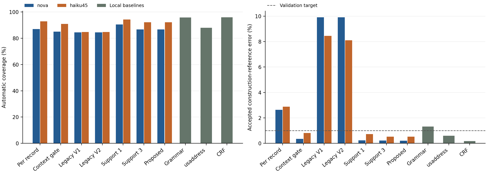

# A Hybrid Symbolic–LLM Framework for Adaptive Name and Address Parsing through Token-Mask Knowledge Acquisition and Deterministic Reuse

**Adeeba Tarannum, Muzakkiruddin Ahmed Mohammed, Shames Al Mandalawi, and John R. Talburt**

Center for Advanced Research in Entity Resolution and Information Quality (ERIQ), University of Arkansas at Little Rock, Little Rock, AR 72204, USA

[Source repository](https://github.com/MohdMuzakkiruddinAhmed/hybrid-symbolic-llm-name-address-parsing) · [Study release and LLM results](https://github.com/MohdMuzakkiruddinAhmed/hybrid-symbolic-llm-name-address-parsing/releases/tag/v0.5.1) · [MIT license](LICENSE)

Research code and released LLM outputs for parsing person names followed by numbered, typed U.S. street addresses. A model proposes token-position mappings; symbolic memory validates, accumulates distinct-input support, reuses accepted mappings and quarantines conflicts.

This repository is the reproducibility companion for the paper named above. It supplies the implemented system, corpus, saved model outputs, evaluation and analysis. See [paper and artifact guide](docs/PAPER.md) for the research questions, evidence and limitations. Citation metadata is in [CITATION.cff](CITATION.cff).

This release contains the exact predictive implementation used in protocol 0.5.0, a 20,000-input corpus snapshot, source provenance, tests, analysis code and measured results. The parser package retains its original 0.1.0 version. Publication release v0.5.1 corrects test dependency setup; the study's v0.5.0 corpus and LLM results archives are unchanged.

## Main results

All three rows below use the same 10,000 final inputs. Error means disagreement with source/construction references among accepted records.

| Method | Accepted | Exact records | Accepted reference error | Logical discovery requests |
| --- | ---: | ---: | ---: | ---: |
| Nova 2 Lite proposed | 8,664 | 8,646 | 0.21% | 4,329 |
| Claude Haiku 4.5 proposed | 9,216 | 9,168 | 0.52% | 4,207 |
| Supervised CRF | 9,591 | 9,574 | 0.18% | 0 |

The proposed policies reduce replay discovery requests by 55.37% and 56.63% against matched context-gated per-record parsing. The CRF has higher coverage and lower aggregate accepted-reference error at these operating points; it uses 5,800 construction-labeled development records. Reuse savings depend on recurrence: about 99% in the engineered recurring regime and about 2% in the long tail.



## Quick start without model calls

Use Python 3.12 or 3.13. Core parsing uses the standard library; the mocked Bedrock adapter tests additionally require the recorded `botocore` version. Tests need no AWS credentials and make no provider calls.

```sh
python -m pip install botocore==1.42.73
python scripts/restore_artifacts.py --dataset-only
python -m unittest discover -s tests -q
python scripts/verify_release.py --dataset-only
python scripts/run_without_wmi.py scripts/run_parser.py demo
```

The bundled corpus archive restores all 20,000 inputs and their original labels and source snapshots. The demo uses engineering fixture proposals and is not an empirical LLM benchmark.

## Reproduce the LLM results

Download [llm-results-v0.5.0.zip](https://github.com/MohdMuzakkiruddinAhmed/hybrid-symbolic-llm-name-address-parsing/releases/download/v0.5.1/llm-results-v0.5.0.zip) into `artifacts/`. In the local prepared distribution it is also available in the sibling `release-assets/` folder.

```sh
python scripts/restore_artifacts.py
python -m pip install -r requirements-research.txt
python scripts/reproduce.py
```

Use `python scripts/reproduce.py --replay` to regenerate all 294 policy evaluations as well as the analysis. These commands use saved model responses and make zero provider calls. The archive contains the two complete 10,000-input final response banks, the matched 250-input Sonnet subset, development/validation banks, per-record predictions, local baseline outputs, stream orders, repeated-generation outputs and the live follow-up.

## Data and annotation scope

The corpus has 10,000 controlled inputs, 6,000 external addresses paired with fictional people, 2,000 safety/ambiguity inputs and 2,000 fresh known-family inputs. Development/validation/final sizes are 6,000/4,000/10,000. The 400 controlled field sequences share 50 address layouts and eight name layouts; they are not 400 independent linguistic phenomena.

Primary references are source/construction-derived. A separate model-assisted audit reviewed 2,000 final inputs twice, using configured `gpt-6.1-sol` with medium reasoning in fresh input-only passes. Human annotation count is zero. Status agreement was 98.3%; disputed and ambiguous cases remain unresolved. The audit is a secondary sensitivity analysis, not independently human-verified ground truth. See [annotation method](docs/ANNOTATION.md).

External addresses come from one North Carolina aggregation service. All evaluated methods receive the declared source name convention. General name disambiguation, universal reuse safety and production savings are not established.

## Documentation

- [Complete result table](results/analysis/tables.md)
- [Reproduction](docs/REPRODUCING.md)
- [System architecture](docs/system_architecture.md)
- [Dataset coverage](docs/dataset_coverage.md)
- [Annotation method](docs/ANNOTATION.md)
- [Related work](docs/related_work.md)
- [Publication provenance](docs/PUBLICATION.md)
- [Third-party notices](THIRD_PARTY_NOTICES.md)
- [Release maintenance](docs/PUBLISHING.md)

Live Bedrock inference is disabled in the distributed runtime config. Re-running inference requires your own AWS access, verified current rates and a separately controlled budget. Historical AWS usage/rate estimates total $30.521921, including four retained unknown reservations; this is not an invoice. Annotation-engine usage is separate.

Project code is MIT licensed. Source data and dependencies retain their own terms. No model weights or credentials are distributed.
