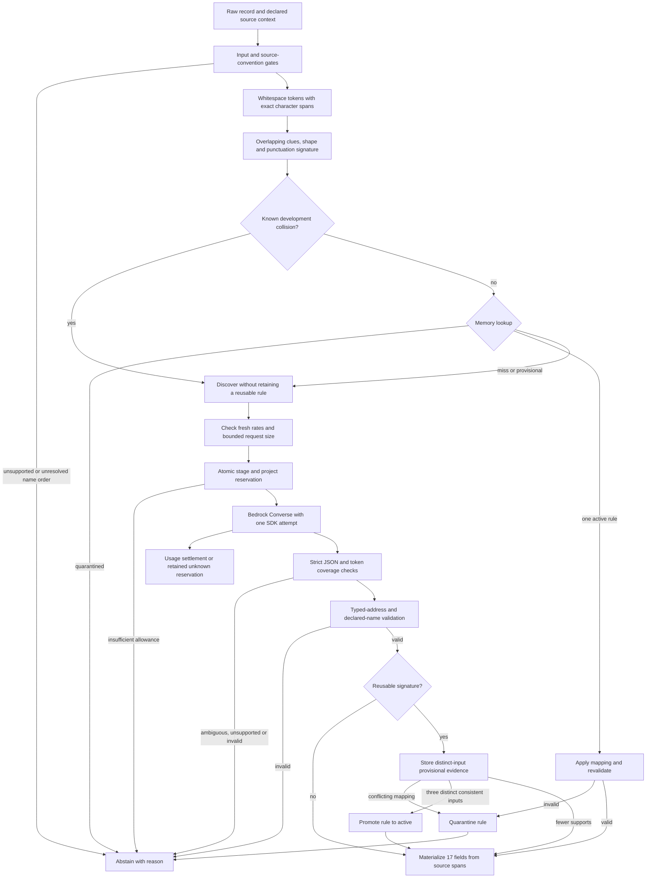
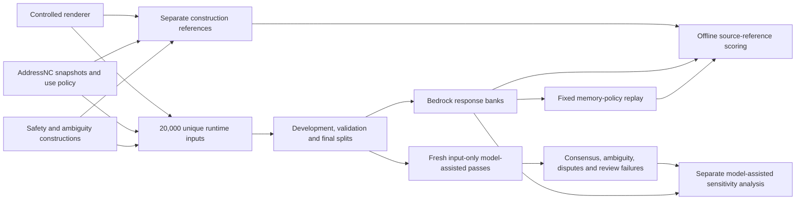

# Implemented architecture, protocol v0.5

The runtime receives four fields: `record_id`, `raw`, `locale`, and optional source-declared `name_order`. Family IDs, source groups, construction mappings and model-assisted reviews are evaluator-only data. The main scientific comparison matches the same name-convention gate in the per-record and proposed policies.

The signature includes schema/tokenizer/encoder versions, locale, the name convention, overlapping clue alternatives, coarse token shapes and punctuation. It omits lexical identities and evaluator metadata. A match is a retrieval heuristic; it does not prove semantic equivalence.

SQLite stores rules, distinct raw-input fingerprints, admission events and validator/promotion-policy bindings. Existing memories with different validator versions are rejected. The production parser can discover observed conflicts, but an already active rule may prevent later discovery calls that would reveal a collision. The experiments measure that remaining propagation risk.

The project ledger preserves every reservation and settlement. A stage redistribution is allowed only as a recorded transaction within the unchanged USD 40 ceiling, with no requests in flight and no removal of committed charges. USD 10 remains outside that operational allocation. Provider errors without usable billing counts retain their full reservations. The ledger is not an AWS invoice.

## Data and reference separation

model-assisted does not see the construction references or Bedrock predictions during annotation. Its two passes use the same model and can share errors. Source-reference agreement and model-assisted-reference sensitivity are reported separately; zero human annotations are claimed. The frozen parser receives neither reference during final inference.

## Comparators and execution

The seven response-bank policies are structural per-record inference, per-record inference with the matched name-convention gate, legacy V1/V2 caching, enriched-context support-one/support-three caching, and the proposed support-three policy with the development collision exclusion. Each order starts with empty memory.

Local comparators are a deterministic grammar, pretrained usaddress with the same declared person-name convention, and a CRF trained on 5,800 mapped development references. Its minimum-token-marginal threshold was selected on validation. A separate label-budget supplement uses validation only.

All main response-bank calls are actual paid provider requests. Policy replay records logical generations requested from those saved responses and makes zero extra provider calls. The separate paired live experiment measures fresh calls and actual parse latency on a declared 50-input recurrence workload.
